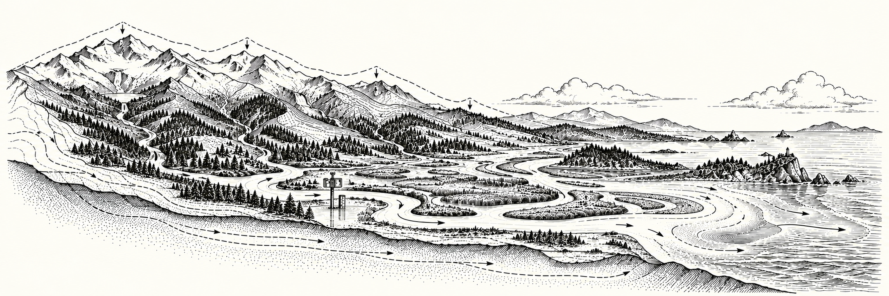

# Hydrology Toolkit



Observed river conditions for MarineCast. The six-river pilot includes Fraser,
Skagit, Snohomish, Nooksack, Cowichan and Columbia. It ingests official USGS OGC v1
and Canadian HYDAT/GeoMet discharge, preserves native daily support, computes causal
features, and optionally builds water-connected H3 association proxies.

**Validated:** 2023-01-01–2023-03-31 discharge for all six stations (90/90 days each),
and daily mean/max temperature for Skagit, Nooksack and Columbia (90/90 each).
Native daily data are not UTC daily data. Production marine mapping remains blocked
by missing versioned water-mask/receiving-region inputs; synthetic spatial tests are
not production validation. See [actual validation](docs/VALIDATION.md).

## Final products

A successful `--make-h3 --temporal-requirement utc_daily` build produces:

```text
RELEASE/final/static.parquet   # h3_index × metric
RELEASE/final/dynamic.parquet  # h3_index × date × metric
RELEASE/final/catalog.json    # inventory, sources, schema, units and checksums
```

All produced static metrics share the static file; all time-varying metrics share the
dynamic file. Dates are typed UTC calendar dates. Values, statuses and contributors
remain explicit. The dynamic file streams one day at a time during construction.

After both final files, their catalog and the release pass saved-output validation,
the build automatically deletes its owned downloaded response files. Failed builds
retain downloads for resumption. External input files and existing shared caches are
preserved. Native/QA outputs remain supporting artifacts outside `final/`. Native-only
pilot runs retain their cache until a final H3 build can be completed.

## Install and test

From this checkout (`MarineCast/Toolkits/toolkit-hydrology` in the inspected workspace):

```bash
python3 -m venv .venv
.venv/bin/python -m pip install -e '.[test]'
.venv/bin/python -m pytest -q
```

No sibling package installation is needed for native data access. Downloads, cache,
virtual environment and releases are ignored by Git. Optional `USGS_API_KEY` raises
provider rate limits; do not store it in a tracked file.

## Bounded pilot and native API

```bash
.venv/bin/python -m hydrology build --config config/pilot.json --dry-run
.venv/bin/python -m hydrology build --config config/pilot.json
.venv/bin/python scripts/validate_pilot.py --report data/pilot-report.json
# Use the release_path printed by build:
.venv/bin/python -m hydrology validate data/releases/RELEASE_ID
# Discovery and coverage use the same explicit selection/configuration:
.venv/bin/python -m hydrology discover --config config/pilot.json
.venv/bin/python -m hydrology audit --config config/pilot.json
```

```python
from hydrology import (
    get_river_discharge, get_river_temperature,
    get_river_context, get_hydrology_features,
)
q = get_river_discharge('2023-01-01', '2023-03-31', rivers=['fraser'], cache='data/cache')
t = get_river_temperature('2023-01-01', '2023-03-31', rivers=['columbia'])
print(t.attrs['outcomes'])  # explicit observed/unsupported/empty/failure outcomes
registry = get_river_context(make_h3=False)
release, manifest = get_hydrology_features('2023-01-01', '2023-03-31', make_h3=False)
```

`bbox=(west,south,east,north)` filters river mouths, never upstream stations. No
production study extent was available, so default native access selects named rivers.
Config defaults to 2009-01-01 through yesterday; **supply bounded dates for tests**.
CLI/function overrides → supplied JSON → optional `MARINECAST_HYDROLOGY_CONFIG` →
package defaults. `--data-source auto` follows registry ownership, with optional local
HYDAT snapshot when supplied. It never silently falls back to modeled data.

## Training-only baseline and later application

The following acquisition is intentionally explicit; it was **not** launched as part
of the 90-day smoke test. Change the dates for your training split.

```bash
.venv/bin/python -m hydrology build --rivers skagit --start-date 2009-01-01 --end-date 2018-12-31 --dry-run
.venv/bin/python -m hydrology build --rivers skagit --start-date 2009-01-01 --end-date 2018-12-31
.venv/bin/python -m hydrology fit-climatology data/releases/TRAIN_RELEASE/river_conditions.parquet --cutoff 2018-12-31 --reference-start 2009-01-01 --output data/baseline.json
.venv/bin/python -m hydrology build --rivers skagit --start-date 2019-01-01 --end-date 2019-03-31 --climatology data/baseline.json
```

An artifact requires 60 seasonal samples from at least 3 distinct training years by
default. A 90-day pilot cannot establish that baseline: its seasonal anomalies remain
unavailable. Apply an existing artifact to saved conditions using `hydrology features
CONDITIONS --climatology BASELINE --output FEATURES.parquet`.

## Strict UTC and H3

A bounded real Columbia UTC check can run without a spatial build:

```bash
.venv/bin/python -m hydrology build --rivers columbia --start-date 2023-01-01 --end-date 2023-01-03 --temporal-requirement utc_daily
```

For H3, provide a reviewed domain, full connected water polygon and named receiving
regions in WGS84 GeoJSON. The files below are **required external inputs**, not bundled
demonstration geometry. Names must match the registry; see [input contract](docs/CONTRACTS.md).

```bash
.venv/bin/python -m hydrology build --config config/pilot.json --rivers columbia --start-date 2023-01-01 --end-date 2023-01-03 --temporal-requirement utc_daily --make-h3 --h3-res 6 --water-mask /path/to/versioned-water.geojson --water-mask-version YOUR_RELEASE --receiving-regions /path/to/receiving-regions.geojson
```

Add `--bbox WEST SOUTH EAST NORTH` using your shared MarineCast study extent.
Provider-native daily builds reject the strict UTC H3 table. Canadian historical daily
data cannot reconstruct UTC; only retention-supported recent timestamped WSC records
can, with `--allow-provisional`. Do not claim a six-river historical UTC table from the
native pilot. H3 metric values are associated **river proxies**, not local seawater,
salinity, plume strength or freshwater fractions.

## Resumable backfill and reconciliation

```bash
# Review all selected rivers and monthly acquisition blocks first:
.venv/bin/python -m hydrology build --start-date 2009-01-01 --dry-run
# Explicit acquisition; defaults end date to yesterday:
.venv/bin/python -m hydrology build --start-date 2009-01-01 --cache data/cache --output data/backfill --workers 1
# Re-running the same command resumes cached pages. A local HYDAT snapshot is optional:
.venv/bin/python -m hydrology fetch --rivers fraser cowichan --start-date 2009-01-01 --hydat /path/to/Hydat.sqlite3
# Refresh a bounded recent/revision window; old releases remain immutable:
.venv/bin/python -m hydrology reconcile --start-date 2026-09-01 --end-date 2026-09-30
```

No multi-decade acquisition was launched. Native-only cached pages are reused until explicit refresh/reconcile; completed H3
builds remove their owned downloads. Cached pages are not evidence of provider freshness. Runtime and
memory have only been measured on bounded pilots. CLI exits 2 for missing required
discharge or spatial build failures, while retaining independent native results.
Python native APIs return outcomes in DataFrame attrs, including empty/gap results.

Read [sources](docs/SOURCES.md), [architecture/contracts/metrics](docs/CONTRACTS.md),
and [validation, performance and remaining gaps](docs/VALIDATION.md) before production
use. Catchment geometry, expanded river curation, supplemental Canadian temperature,
meteorological basin aggregation, modeled fallback and transport remain extension work.
