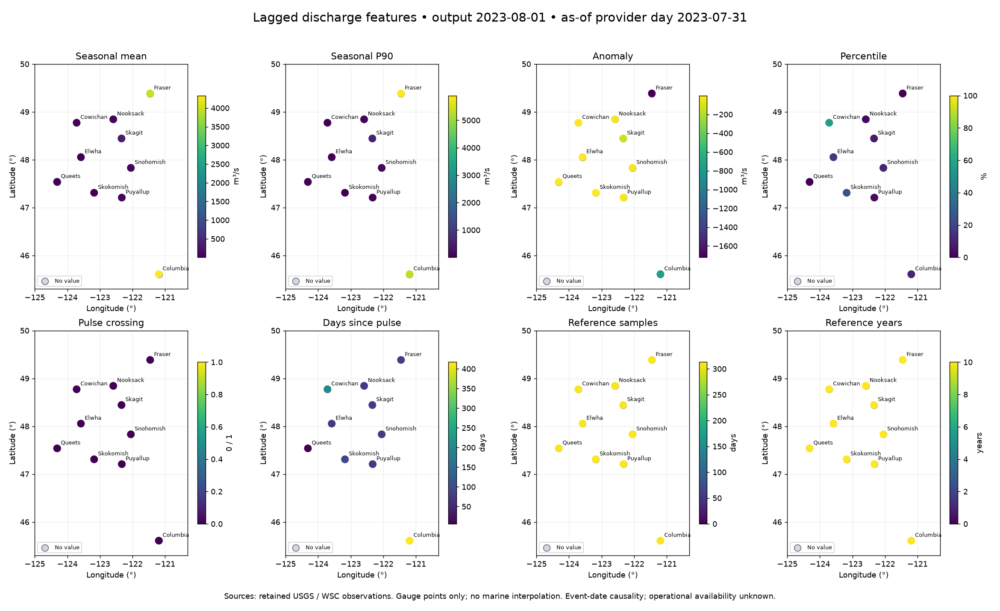
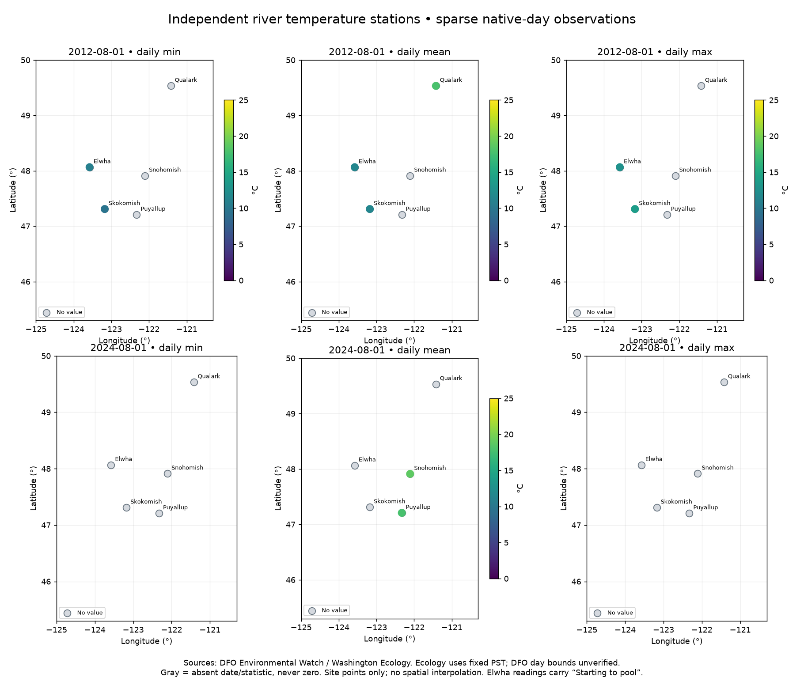
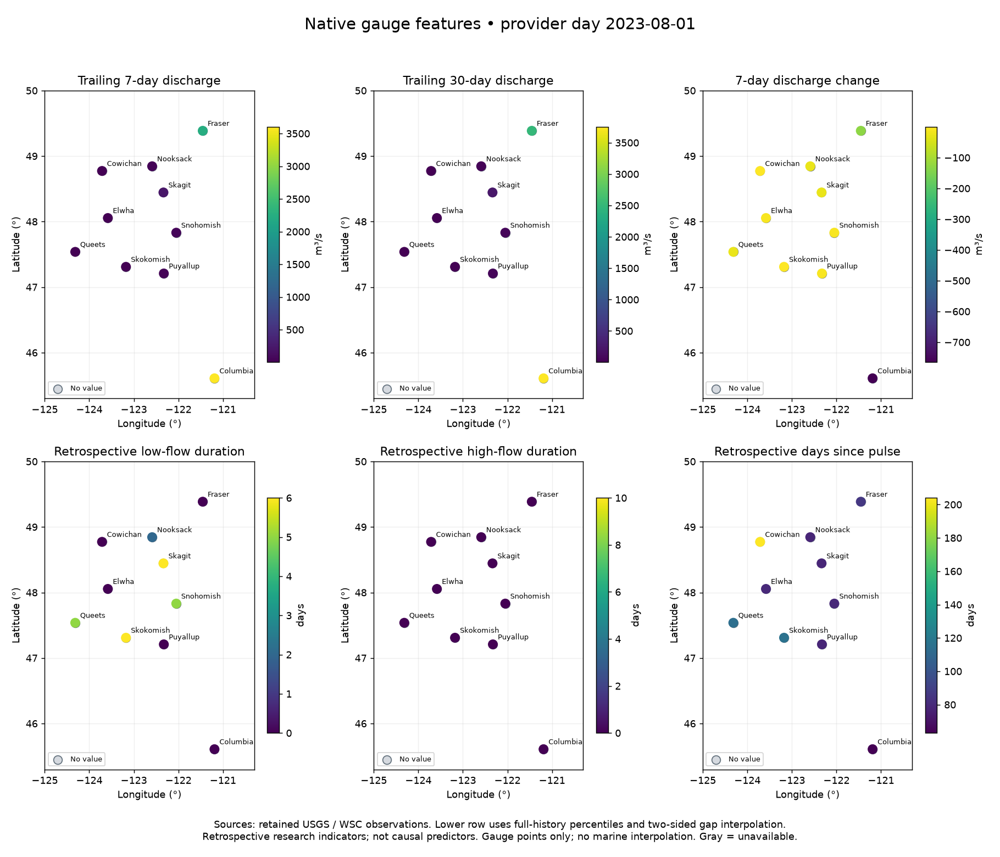
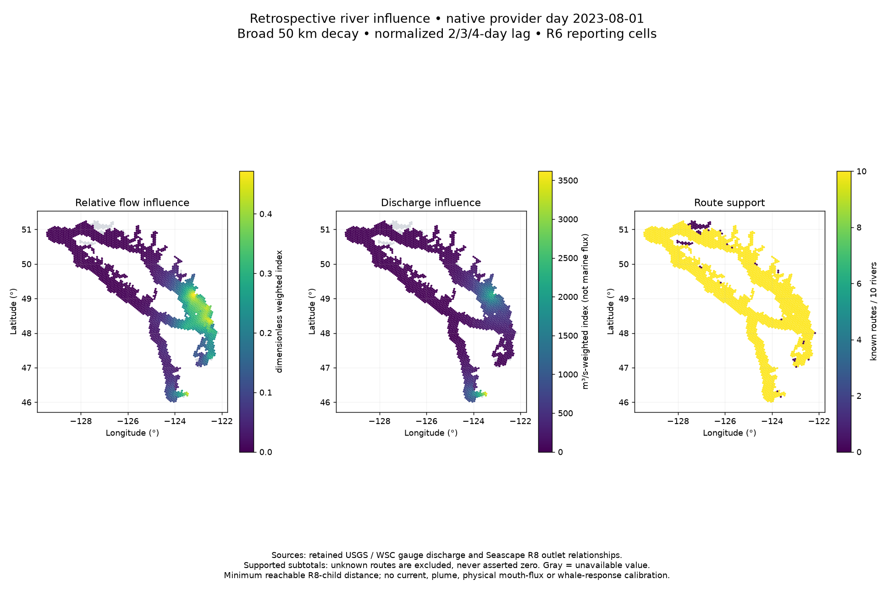

# Retained-input reproducibility review — 2026-10-29

The installed package regenerated **519,760 causal discharge rows** (ten rivers,
eight metrics, 2009-01-01–2026-10-15) and **5,301 independent temperature rows**
from the retained sources. Sorted keys, all row fields, exact numeric values,
null masks, statuses, reasons and provenance columns matched the delivered tables.
Causal null count was 68,501. Every delivered product file retained its SHA256.
This is full retained-input replay for these two companions, **not** fresh source
recollection, validation of every hydrology layer, or proof of historical operational
availability. Parquet byte identity is not required; regenerated metadata and encoding
can differ. Summary/checksums and environment versions are in
[review evidence](reproducibility-review.json).

| Station | Rows | Statistics | Observed dates (gaps retained) |
| --- | ---: | --- | --- |
| Qualark | 217 | mean | 2009-07-01–2026-09-20 |
| Puyallup 10A040 | 842 | mean | 2023-11-15–2026-03-22 |
| Snohomish 07A089 | 1,077 | mean | 2023-07-14–2026-10-27 |
| Elwha 18B070 | 909 | 303 each min/mean/max | 2009-06-19–2012-09-19 |
| Skokomish 16A070 | 2,256 | 752 each min/mean/max | 2009-06-19–2017-09-13 |

## Repeat without publishing

From the toolkit checkout, install a regular package into an isolated environment.
The review used Python 3.14.0, pandas 3.1.0, NumPy 2.5.4, PyArrow 26.0.0 and
pyproj 3.8.0. `pdftotext` (Poppler) must be on PATH for retained DFO PDFs.
The local `.venv` was absent; the temporary environment below was used instead.

```sh
python3 -m venv /tmp/hydrology-review-env
/tmp/hydrology-review-env/bin/pip install '.[test]' matplotlib
/tmp/hydrology-review-env/bin/python scripts/review_replay.py \
  --product ../../Data/Hydrology \
  --sources ../../.marinecast-work/hydrology/4625475e62f6a93b/station-temperature-sources \
  --output /tmp/hydrology-review-replay
DATA_DIR=/tmp/hydrology-review-test-data /tmp/hydrology-review-env/bin/python -m pytest -q -p no:cacheprovider
MPLCONFIGDIR=/tmp/hydrology-review-mpl /tmp/hydrology-review-env/bin/python scripts/example_maps.py \
  --product ../../Data/Hydrology --output /tmp/hydrology-review-maps
```

`review_replay.py` uses installed package calculations and explicitly loads the
checkout's existing DFO import helpers. It never calls acquisition or publication.
Source ledgers currently contain absolute local paths; a moved source store requires
explicit path rebasing while retaining hashes. Required inputs are all ten retained
`conditions.parquet` files, delivered companions/catalog, DFO import and historical
ledgers and original report files, two DataStream ZIPs with their ledger, and both
EIM extracted folders with source manifests. It verifies source hashes and compares
the complete causal definition. EIM coordinates/day definitions are recomputed and
compared; other curated station metadata is preserved from delivery, not independently
re-surveyed. Temperature rows are reconstructed, but the final test table deliberately
reuses delivered station/provenance metadata; it does not prove metadata regeneration.

The original owner-command test run had 255 passes and one failure: local `.env`
selected a delivery directory that is read-only in this sandbox. With the explicit
writable temporary `DATA_DIR`, **256 tests passed**. There were 23,790 pandas
deprecation warnings. This is recorded environment sensitivity, not a production
permission change. No scientific code fixes were necessary. No dedicated docs build
is configured; Markdown links, Python syntax and `git diff --check` were checked.

## Semantics and manual prerequisites

See [causal definitions](CAUSAL_FEATURES.md) and
[station temperature qualification](STATION_TEMPERATURE.md) for the full schema.
Causal baseline/percentile/pulse references use completed prior calendar years and
lag one native provider day; missing observations reset pulse knowledge. They remain
`model_eligible=false`: publication delays and historical revisions are unknown.
Native civil dates must not be called UTC dates. Discharge is m³/s; temperature °C.

DFO HTML/PDF/image sources include hash-pinned manually reviewed transcriptions;
the replay verifies these pinned rows, not an independent interpretation of images.
DataStream ZIPs were obtained through the authorized browser workflow; the EIM
five-CSV-plus-disclaimer exports were manually supplied after access blocks. These
manual acquisitions are prerequisites, not automated toolkit downloads. No blocked
endpoint was retried. EIM original ZIPs were not retained, so ZIP CRC is unverified.
Source disclaimer files and recorded rights/attribution requirements remain with
originals. This review makes no new license determination or redistribution grant;
see the recorded DFO noncommercial attribution/commercial permission qualification
in the station documentation before distributing data or maps.

Ecology uses explicitly fixed PST/GMT−8, never DST or relabeled UTC. EIM daily
min/mean/max summaries are corroborated by 48 unique half-hour readings; extreme
occurrence times are not daily interval boundaries. Reviewed, provisional and
unchecked flags remain explicit; `valid` means parser acceptance. Elwha's “Starting
to pool” comment remains. Missing dates are absent, not zeros or interpolations.
DFO timezone boundaries remain unverified; Qualark is not Hope. See source docs for
coordinate datum uncertainty and EIM NAD83(HARN)→WGS84 transformations.

## Example maps

The examples are station-coordinate maps with latitude/longitude axes, no downloaded
basemap and no interpolation to marine cells. Colors show actual selected-date values;
gray markers show unavailable date/statistic. Temperature panels share 0–25°C scaling;
percentile, pulse and reference counts use fixed meaningful ranges. These local docs
assets were rendered and inspected; they are not publicly published.





## Expanded native-feature and influence review — 2026-10-29

The resumed review reproduced **844,610 native feature rows** (84,461 per river,
13 metrics, ten rivers), including **352,221 nulls**, with exact sorted row parity.
It used installed `build_features`, `replace_low_flow`, `replace_flow_pulse` and
`replace_high_flow`, with the retained manifest configuration and publication Arrow
schema. No training climatology was configured; the corresponding seasonal fields
remain unavailable. Full-history thresholds and two-sided interpolation remain
retrospective and unsuitable as causal predictors.

**Warmup is required:** Elwha, Puyallup, Queets and Skokomish each retain 30 selected
pre-window discharge days (120 total rows). An initial conditions-only replay failed
on the early rolling averages/changes. Including `warmup.parquet` before calculating
trailing features and cropping to the requested window reproduced the delivery.
Retrospective percentile replacements then use only retained in-window conditions,
as the owning processing pipeline does. This is a replay prerequisite, not a change
to scientific methods or delivered data.

The installed `build_influence` pipeline regenerated all **267,720 factors**:
72,810 spatial rows (2,427 R6 cells × ten rivers × three distance profiles) and
194,910 temporal rows (6,497 days × ten rivers × three lag profiles). Every typed
row, value and null matched exactly. All **26 source bindings** matched stored
SHA256 values: native conditions/manifests, configuration, study manifest/membership,
Seascape selected-outlet bindings and R8 relationship table. These products are
present locally; no sibling toolkit implementation is imported. The complete dated
[inventory and results](remaining-review.json) records counts and bindings.

To keep production immutable, `review_remaining.py` intercepts only the pipeline's
snapshot context and final writer/catalog-write boundary: calculations, input binding
checks and pre-write source-stability checks run from the installed package; the
result writes to temporary Parquet. Any attempted catalog mutation fails. This is
not a replay of locking or publication transactions. Runtime/implementation metadata
and recipe identity can differ; logical factor equality is the acceptance criterion.
Original product SHA256 checks before/after confirmed no changes.

```sh
/tmp/hydrology-review-env/bin/python scripts/review_remaining.py \
  --product ../../Data/Hydrology --config config/river-influence.json \
  --output /tmp/hydrology-review-remaining
MPLCONFIGDIR=/tmp/hydrology-review-mpl /tmp/hydrology-review-env/bin/python scripts/example_legacy_maps.py \
  --product ../../Data/Hydrology --output /tmp/hydrology-review-maps/legacy-features.png
MPLCONFIGDIR=/tmp/hydrology-review-mpl /tmp/hydrology-review-env/bin/python scripts/example_influence_map.py \
  --product ../../Data/Hydrology --output /tmp/hydrology-review-maps/influence-example.png
```





The influence map evaluates installed `combine` on the delivered factors for one
native provider date, broad distance profile and three-day lag. Values are supported
subtotals, with known-route counts alongside; an unknown route is not a known zero.
Spatial support is minimum reachable R8 child distance within each R6 cell, not a
center distance or area mean. Discharge influence has m³/s-weighted index units;
it is not physical marine flux, salinity, freshwater fraction or a calibrated plume.
Source-registration limits, the estuarine Columbia origin, unknown transport and
nonsimultaneous provider days remain as documented in [river influence](RIVER_INFLUENCE.md).

## Delivered inventory and remaining boundaries

The current `Data/Hydrology` inventory comprises ten native river directories,
`catalog.json`, `owner.json` and three companions: causal, influence and independent
station temperature. Each river retains observations, conditions, warmup, features,
coverage, acquisition ledger, metadata and manifest. Totals are 94,293 normalized
observations, 194,910 calendar-condition rows, 120 warmup rows and 2,160 coverage rows.
Observations preserve provider series/flags/source hashes; conditions encode selected
source eligibility and explicit expected-calendar missingness. Feature replay uses
those retained normalized conditions; it does not rerun raw provider acquisition or
independently revalidate the normalized-observation→condition selection decision.
Coverage and acquisition ledgers are inventoried and checksum-preserved, not regenerated.

There is **no delivered strict-UTC H3 `final/` product** in `Data/Hydrology`, nor a
retained `final/static.parquet`/`final/dynamic.parquet` under this toolkit's `data/`.
The influence R6 factors are a different, provider-day research product and must not
be represented as strict UTC H3 output. Historical cache directories contain three
superseded influence release layouts; they are not current delivered products and
were not rebuilt or deleted. Strict-UTC H3 production still requires qualified UTC
support and explicit versioned water-mask/receiving-region inputs; the current native
manifests have these spatial inputs unset. No substitute geometry was invented.

Full retained-history replay now covers the current derived features and all three
companions. Remaining gaps are upstream acquisition/normalization, condition-selection
and coverage regeneration, publication transactions, source freshness, historical
operational vintages and scientific model readiness. No new provider collection,
publication, code-method change or full-history download occurred. The previous
256-test pass remains applicable; added audit/map scripts were executed, parsed and
link/diff-checked. New maps were visually inspected.
